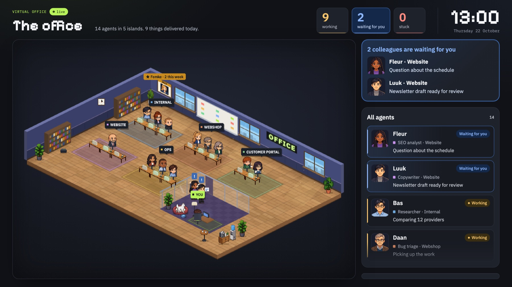

# Kantoor

*Kantoor* is Dutch for "office". It is a virtual office where your Claude agents work as colleagues at desk islands. Every project or client gets its own island. You see live who is busy, who is waiting for you, who is stuck and who is handing work to a colleague. You answer questions from agents in the office itself, and you can keep the office running full screen on a TV.



Agents come in two ways:

- **Claude (web, desktop, mobile), skills, scheduled tasks and cloud sessions** report through an MCP connector.
- **Claude Code** reports through hooks: every session automatically becomes a colleague at the island of the repository you are working in.

Kantoor is a Laravel app you host yourself. Each installation belongs to one person or one team: everyone with an account sees the whole office.

## Contents

1. [Requirements](#requirements)
2. [Try it locally first](#try-it-locally-first)
3. [Install on a server](#install-on-a-server)
4. [Connect Claude](#connect-claude)
5. [Connect Claude Code](#connect-claude-code)
6. [Weekly usage on the whiteboard (optional)](#weekly-usage-on-the-whiteboard-optional)
7. [Reporting from a skill](#reporting-from-a-skill)
8. [The office on a TV](#the-office-on-a-tv)
9. [Ringing the phone on errors (optional)](#ringing-the-phone-on-errors-optional)
10. [Projects (islands)](#projects-islands)
11. [Settings](#settings)
12. [Updating](#updating)
13. [Troubleshooting](#troubleshooting)
14. [Privacy and security](#privacy-and-security)

## Requirements

- PHP 8.4 or higher with the `sqlite3` (or `pdo_mysql`), `mbstring`, `openssl`, `curl` and `zip` extensions
- Composer
- For a server: a (sub)domain with HTTPS, Nginx, and a way to keep a process running in the background (Supervisor, systemd or Laravel Forge)
- A Claude plan that lets you add custom connectors, and/or Claude Code

You don't need Node.js: the CSS and JavaScript are ready to use in `public/`.

Kantoor uses SQLite by default, which is plenty. If you prefer MySQL or PostgreSQL, fill in the `DB_*` lines in `.env`.

## Try it locally first

```bash
git clone https://github.com/SERFF/kantoor-public.git kantoor
cd kantoor
composer install
cp .env.example .env
php artisan key:generate
touch database/database.sqlite
php artisan migrate
php artisan passport:keys
```

For local use, set these in `.env`:

```dotenv
APP_URL=http://127.0.0.1:8000
KANTOOR_WS_HOST=127.0.0.1
KANTOOR_WS_PORT=8080
KANTOOR_WS_SCHEME=http
REVERB_APP_ID=kantoor
REVERB_APP_KEY=local-key
REVERB_APP_SECRET=local-secret
```

Create an account:

```bash
php artisan kantoor:invite you@example.com
```

This prints a link that is valid for 30 minutes. Open it and choose a password (at least 12 characters).

Then start these in three terminals:

```bash
php artisan serve           # the app on http://127.0.0.1:8000
php artisan reverb:start    # live updates (websockets) on port 8080
php artisan kantoor:demo    # fills the office with demo colleagues for 5 minutes
```

Open `http://127.0.0.1:8000`, log in and watch. Remove the demo colleagues with `php artisan kantoor:demo --clear`.

> A local installation is great for a look around, but Claude on the web cannot reach `127.0.0.1`. For the connector you need a server with a public HTTPS address. Claude Code hooks do work locally.

## Install on a server

The examples use `kantoor.example.com`. Replace it with your own domain everywhere.

### 1. Domain and site

Point the domain at your server and create a site with the `public/` folder as document root. Request an HTTPS certificate (for example Let's Encrypt). HTTPS is required: the Claude connector only works over HTTPS.

**With Laravel Forge:** create a new Laravel site, connect your fork of this repository, choose PHP 8.4 or higher and request a Let's Encrypt certificate.

### 2. Code and `.env`

```bash
git clone https://github.com/SERFF/kantoor-public.git /var/www/kantoor
cd /var/www/kantoor
composer install --no-dev --optimize-autoloader
cp .env.example .env
php artisan key:generate
touch database/database.sqlite
```

Fill in at least the following in `.env`:

```dotenv
APP_ENV=production
APP_DEBUG=false
APP_URL=https://kantoor.example.com

BROADCAST_CONNECTION=reverb
REVERB_APP_ID=pick-a-random-string
REVERB_APP_KEY=pick-a-random-string
REVERB_APP_SECRET=pick-a-long-random-string
REVERB_HOST=127.0.0.1
REVERB_PORT=8080
REVERB_SCHEME=http
REVERB_SERVER_HOST=127.0.0.1
REVERB_SERVER_PORT=8080

KANTOOR_WS_HOST=kantoor.example.com
KANTOOR_WS_PORT=443
KANTOOR_WS_SCHEME=https
```

You can generate random strings with `openssl rand -hex 20`.

How the traffic flows: the app talks to Reverb internally on `127.0.0.1:8080`, and the browser opens a secure websocket through Nginx to `wss://kantoor.example.com/app`.

With Forge you enter these values on the site's Environment page.

### 3. Database and keys

```bash
php artisan migrate --force
php artisan passport:keys
php artisan optimize
```

`passport:keys` creates the keys the connector uses to log in (`storage/oauth-*.key`). Do this once and keep the files on later deploys.

Make sure the web server can write to `storage/`, `bootstrap/cache/` and `database/` (because of SQLite).

### 4. Reverb (live updates)

Reverb must always be running. **With Forge:** enable the Reverb integration on the site, with host `kantoor.example.com` and port 8080. Forge then creates the background process and the Nginx proxy, and this step is done.

**Without Forge**, create a Supervisor program, for example `/etc/supervisor/conf.d/kantoor-reverb.conf`:

```ini
[program:kantoor-reverb]
command=php /var/www/kantoor/artisan reverb:start --host=127.0.0.1 --port=8080
directory=/var/www/kantoor
user=www-data
autostart=true
autorestart=true
stopwaitsecs=3600
```

```bash
sudo supervisorctl reread && sudo supervisorctl update
```

And add this `location` to the `server` block of your Nginx config:

```nginx
location /app {
    proxy_http_version 1.1;
    proxy_set_header Host $http_host;
    proxy_set_header Scheme $scheme;
    proxy_set_header SERVER_PORT $server_port;
    proxy_set_header REMOTE_ADDR $remote_addr;
    proxy_set_header X-Forwarded-For $proxy_add_x_forwarded_for;
    proxy_set_header Upgrade $http_upgrade;
    proxy_set_header Connection "Upgrade";
    proxy_pass http://127.0.0.1:8080;
}
```

```bash
sudo nginx -t && sudo systemctl reload nginx
```

### 5. Scheduler

Every minute, `kantoor:check` decides who is stuck, who is done and who can go home. Enable the Laravel scheduler for it.

**With Forge:** server → Scheduler → new job `php /home/forge/kantoor.example.com/artisan schedule:run`, every minute.

**Without Forge:** run `sudo crontab -u www-data -e` and add:

```cron
* * * * * cd /var/www/kantoor && php artisan schedule:run >> /dev/null 2>&1
```

You don't need a queue worker.

### 6. Your account

```bash
php artisan kantoor:invite you@example.com --name="Your name"
```

Open the link it prints (valid for 30 minutes) and choose a password. To give a colleague or housemate access, do the same with their email address. There is no public sign-up. Forgot your password? Run `kantoor:invite` again for the same address.

### 7. Check

- `https://kantoor.example.com` shows the login screen, and after logging in the office with the live indicator in the top right.
- `https://kantoor.example.com/.well-known/oauth-authorization-server` returns JSON. That means the connector is ready to be connected.

### Deploy script (Forge)

```bash
cd $FORGE_SITE_PATH
git pull origin $FORGE_SITE_BRANCH
$FORGE_COMPOSER install --no-dev --no-interaction --prefer-dist --optimize-autoloader
$FORGE_PHP artisan migrate --force
$FORGE_PHP artisan optimize
$FORGE_PHP artisan reverb:restart
```

## Connect Claude

1. In Claude, go to **Settings → Connectors → Add custom connector**.
2. Enter `https://kantoor.example.com/mcp` as the URL.
3. You are sent to your office. Log in and click **Allow**.

Claude then gets five tools:

| Tool | What it does |
|---|---|
| `report_status` | Reports `working`, `waiting` (waiting for you), `done`, `error`, `idle` or `sleeping`, with a short line of text. The first report creates the colleague and gives them a desk. With `question` (and optionally `options`) the agent asks something you answer in the office. |
| `hand_off` | Shows work moving to a colleague. |
| `get_answer` | Fetches your answer to a question you answered in the office. |
| `office_overview` | Who is doing what, for example for "who is waiting for me?". |
| `day_summary` | End-of-day recap: what was delivered per project and what is still open. |

The connector tells Claude by itself when to report. If you want Claude to report in every chat, add a line to your personal preferences (Settings → Profile), for example:

```text
If the Kantoor connector is available, report work that is more than a quick question to the office:
working when you start, waiting when you need me, done with a one-line result, error when you get stuck.
Use a fixed agent name per project, and the name of the project or client as project.
```

Subagents are reported by the agent that starts them, each with its own name. Names ending in `-researcher`, `-builder`, `-reviewer` or `-tester` (optionally with a number, like `webshop-builder-2`) are placed next to the agent named by the first part. For other names, pass `parent` to `report_status`.

## Connect Claude Code

On the server, create one token per computer:

```bash
php artisan kantoor:hook-token "Laptop"
```

This prints a `hooks` block. Merge it with the existing `hooks` in `~/.claude/settings.json` on that computer (if there is nothing yet, paste the whole block). Restart Claude Code.

From then on every session becomes a colleague at the island of the repository you are working in: the folder directly under `Code/`, `Herd/`, `Projects/` or `Sites/` in your home folder (change this with `KANTOOR_CODE_ROOTS`). You see what the session is doing (editing a file, running the tests), when it is waiting for permission and when it is done. Subagents become separate colleagues next to the session.

The hooks use `curl` with a 2-second timeout and fail silently. If the office is briefly unreachable, Claude Code doesn't notice. Revoke a token with:

```bash
php artisan kantoor:hook-token "Laptop" --revoke
```

## Weekly usage on the whiteboard (optional)

The whiteboard in the office can show how much of your weekly Claude Code usage limit is used and how much is left. Claude Code passes these numbers to its status line, so a small wrapper script forwards them to the office.

1. Install `jq` if you don't have it (`brew install jq` or `sudo apt install jq`).
2. Copy the script from this repository and make it executable:

   ```bash
   mkdir -p ~/.claude/hooks
   cp resources/statusline/kantoor-usage.sh ~/.claude/hooks/
   chmod +x ~/.claude/hooks/kantoor-usage.sh
   ```

3. Add a status line to `~/.claude/settings.json`:

   ```json
   "statusLine": {
     "type": "command",
     "command": "KANTOOR_URL=https://kantoor.example.com ~/.claude/hooks/kantoor-usage.sh"
   }
   ```

   Already have a status line of your own? Put its command in `KANTOOR_STATUSLINE` and the script passes everything through to it:

   ```json
   "command": "KANTOOR_URL=https://kantoor.example.com KANTOOR_STATUSLINE='your-statusline-command' ~/.claude/hooks/kantoor-usage.sh"
   ```

The script uses the hook token from your `settings.json` (or `KANTOOR_TOKEN` if you set it), only sends when the numbers change or every 10 minutes, and never blocks the status line.

## Reporting from a skill

In a skill of your own, state at the top of `SKILL.md` when to report, for example:

```markdown
## Office
Report to the office with `report_status` (agent: `weekly-report`, project: `Internal`, role: `Writer`):
- `working` when you start;
- `waiting` when something is ready to review or you have a question, saying what you need from me;
- `done` at the end with a one-line result, or `error` with the reason.
```

Always use the same name for `agent`, so it stays the same colleague.

## The office on a TV

At `https://kantoor.example.com/tv` you see the TV view when you are logged in. For a TV you don't want to log in on, create a view-only link:

```bash
php artisan kantoor:tv-link "Living room"
```

Open the link in the TV's browser. Anyone with the link can watch (not change anything), so don't share it further. Revoke it with `--revoke`.

## Ringing the phone on errors (optional)

Kantoor can make the phone on your desk ring when your error monitor reports a new error. Create a webhook URL:

```bash
php artisan kantoor:alert-link "Monitoring"
```

The URL is shown only once. Your monitor sends a `POST` with JSON in this format:

```json
{
  "action": "new_issue",
  "project": { "name": "Webshop", "slug": "webshop" },
  "issue": {
    "id": 42,
    "short_id": "WEBSHOP-42",
    "level": "error",
    "times_seen": 3,
    "url": "https://monitor.example.com/issues/42"
  }
}
```

`action` is `new_issue`, `regression`, `frequency` or `test`. Only `action`, `project.name` and `issue` are required. If your monitor can't send this format itself, put a small translation step in between (for example in n8n, Zapier or a script of your own).

**Without a token in the URL.** If your monitor runs on a server with a fixed IP address, you can also use `https://kantoor.example.com/api/hooks/alerts` without a token. Only the addresses in `KANTOOR_ALERT_IPS` (comma-separated) are accepted; with no addresses set, this URL is closed.

An alert appears at the top of the office with a link to the issue and a button to pick up the phone, and the island with the same project name flashes. The same issue doesn't ring again while the phone is already ringing. It stops after an hour (`KANTOOR_ALARM_MINUTES`) or when you pick up. Kantoor only stores the project, issue code, level, count and link, never the error message itself.

## Projects (islands)

A project is created automatically on the first report. Manage projects with `kantoor:project`:

```bash
php artisan kantoor:project                                     # list
php artisan kantoor:project Webshop --match="webshop*,shop-api" # folders that belong to Webshop
php artisan kantoor:project Webshop --merge=webshop-2026        # merge a duplicate island
php artisan kantoor:project Webshop --rename="Web store"        # rename
php artisan kantoor:project Internal --position=9               # order of the islands
```

You change a colleague's name, role and project in the office itself by clicking on the character.

## Settings

Everything lives in `.env`. After a change, run `php artisan optimize`.

| Variable | Default | What |
|---|---|---|
| `KANTOOR_BRAND` | empty | Name at the top of the office and on the TV, for example your company name |
| `KANTOOR_SIGN` | `OFFICE` | Text on the neon sign on the wall (max. 10 characters) |
| `KANTOOR_DOG` | `Yuki` | Name of the office dog |
| `KANTOOR_TIMEZONE` | `Europe/Amsterdam` | Time zone for day and night, Friday drinks and the logbook |
| `KANTOOR_CODE_ROOTS` | `Code,Herd,Projects,Sites` | Folders that contain your Claude Code repositories |
| `KANTOOR_TIMEOUT_MCP` | `30` | Minutes of silence before a working agent counts as stuck |
| `KANTOOR_TIMEOUT_CLAUDE_CODE` | `20` | The same for Claude Code sessions |
| `KANTOOR_DONE_TO_IDLE` | `15` | Minutes after `done` until someone is available again |
| `KANTOOR_IDLE_OFFLINE_AFTER` | `30` | Minutes available without work before someone goes home |
| `KANTOOR_OFFLINE_AFTER` | `120` | Minutes of silence before a Claude Code session goes home |
| `KANTOOR_FORGET_OFFLINE_AFTER` | `7` | Days before a session that went home is forgotten |
| `KANTOOR_KEEP_LOG` | `365` | Days that deliveries stay in the logbook |
| `KANTOOR_ALARM_MINUTES` | `60` | How long the phone keeps ringing |
| `KANTOOR_ALERT_IPS` | empty | IP addresses allowed to post alerts without a token |
| `MCP_REDIRECT_DOMAINS` | `https://claude.ai,https://claude.com` | Where the connector may return to after logging in |

## Life in the office

- On a hand-off, the colleague walks a folder over to the desk of whoever gets the work.
- Colleagues who have been available for a while sometimes chat in the coffee corner. On Fridays between 16:00 and 19:00 it's Friday drinks.
- The office dog lies down next to whoever is stuck, says good morning and begs at the coffee corner.
- In the evening the desk lamps come on and the sky changes colour at sunrise and sunset.
- At `/logbook` you see per day what was delivered, filtered by project and period. Whoever delivered the most in the past week hangs on the wall as employee of the week.

## Updating

```bash
git pull
composer install --no-dev --optimize-autoloader
php artisan migrate --force
php artisan optimize
php artisan reverb:restart
```

With Forge, the deploy script does this for you.

## Troubleshooting

**The live indicator keeps saying it is connecting.** The browser can't reach Reverb. Check that Reverb is running (`supervisorctl status` or Forge → Daemons), that the Nginx `location /app` is in place, and that `KANTOOR_WS_HOST`, `KANTOOR_WS_PORT=443` and `KANTOOR_WS_SCHEME=https` are correct. Then run `php artisan optimize`.

**Connecting the connector fails.** Open `https://kantoor.example.com/.well-known/oauth-authorization-server`. No JSON? Then the keys are missing (`php artisan passport:keys`) or `APP_URL` is wrong. Also check that `MCP_REDIRECT_DOMAINS` contains the Claude domains.

**Claude Code doesn't show up.** Test from that computer with the `curl` line from `settings.json`, without `-s -o /dev/null`. A `401` means a wrong or revoked token. If the session lands on the wrong island, set `--match` on the project or adjust `KANTOOR_CODE_ROOTS`.

**Colleagues stay "working" forever.** The scheduler isn't running. Check the cron job or Forge → Scheduler.

**The whiteboard shows no weekly usage.** Check that `jq` is installed, that `KANTOOR_URL` is set in the status line command, and that the script is executable.

**Something else goes wrong.** Look in `storage/logs/laravel.log`.

## Privacy and security

- Prompts and file contents from Claude Code are never stored. Of tool use, Kantoor only keeps the kind of action and the file name.
- Hook tokens, TV links and alert links are stored only as hashes and can be revoked one by one.
- Everyone with an account sees everything in the installation. Only give accounts to people who may see everything.
- Reports appear on a screen others may see. The connector asks Claude not to put personal data, email addresses or customer content in reports, but check your own skills for this too.

Found a security issue? See [SECURITY.md](SECURITY.md).

## Development

```bash
php artisan test
```

## License

MIT, see [LICENSE](LICENSE).

---

Built by [Serff Webdevelopment](https://serff-webdevelopment.nl/maatwerk-software), custom software and AI implementation.
